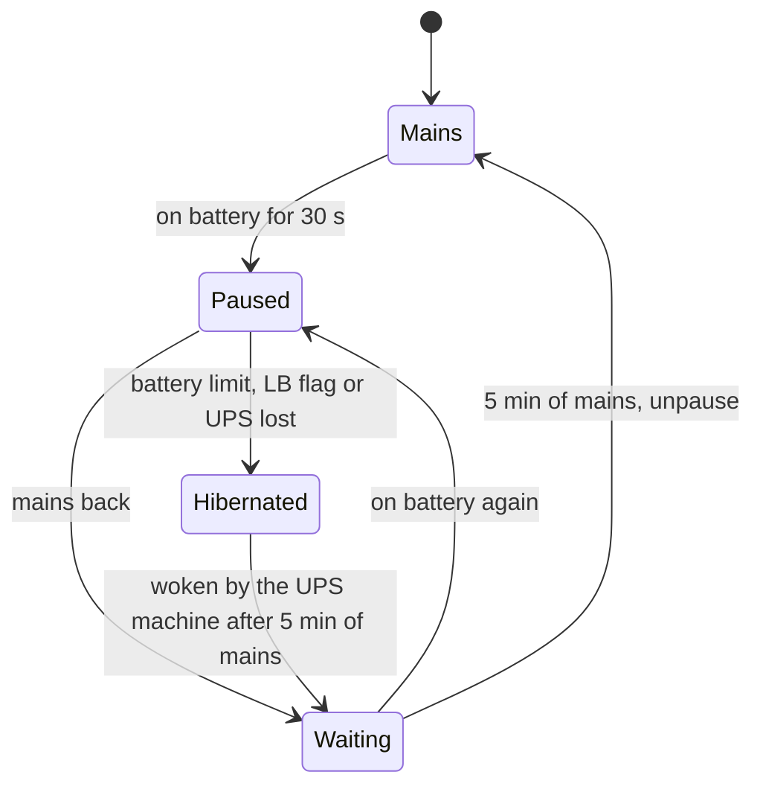

# ups-power

Rides out power cuts on a UPS. When the UPS goes on battery, `ups-power` pauses the containers that use the most power. Before the battery runs out it hibernates the server, which saves everything in memory to disk and powers off. Once the power has been back for 5 minutes, the machine the UPS is plugged into wakes the server, and the containers are unpaused.

It runs on the host itself as a systemd service, not in Docker, and reads the UPS through [NUT](https://networkupstools.org/) (Network UPS Tools).



## What you need

- **systemd** on the host, and **`upsc`** from the `nut-client` package.
- **A NUT server** for the UPS. It can be on the host itself (`ups@localhost`) or on another machine, like a Raspberry Pi with the UPS plugged into it by USB.
- **For hibernation:** swap at least as big as the memory in use, on a disk that isn't ZFS (a swap file on ext4 or xfs, or a swap partition), Secure Boot off, and GRUB with initramfs-tools (Ubuntu, Debian). `manage.hibernate.sh` checks all of these.
- **For waking up:** a network card and BIOS that support Wake-on-LAN from hibernation (S4), and a machine that stays up while the server is off to send the wake packet. That's usually the one running the NUT server.

## Files

| File | What it is |
| --- | --- |
| `ups-power.sh` | The script itself. The service runs `ups-power.sh run`; the other commands are for running by hand (below) |
| `ups-power.service` | The systemd unit, installed by `manage.install.sh` |
| `manage.install.sh` | `./manage.sh run ups-power install [install\|uninstall\|status]` |
| `manage.hibernate.sh` | `./manage.sh run ups-power hibernate [show\|apply]`: tells the kernel where to resume from. Never reboots |
| `manage.wakeonlan.sh` | `./manage.sh run ups-power wakeonlan [show\|apply]`: turns on Wake-on-LAN now and for the next boot |
| `ups-wake.sh`, `ups-wake.service` | For the machine with the UPS: wakes the server after an outage |
| `logs/` | A CSV of every outage, a reading every 10 seconds |

By hand, as root:

```bash
sudo bash ups-power/ups-power.sh status          # The UPS reading, the mode, and what would be paused
sudo bash ups-power/ups-power.sh pause           # Pause the containers now
sudo bash ups-power/ups-power.sh unpause         # Unpause them, waiting for healthchecks before the watchdogs
sudo bash ups-power/ups-power.sh hibernate-test  # Pause, hibernate, and unpause once woken
```

## How it decides

**Pausing.** After `UPS_POWER_PAUSE_AFTER` seconds on battery, it pauses the containers labelled `ups-power.pause: "true"`. In this repository those are `tdarr`, `tdarr-node`, `handbrake`, `libretranslate`, `subgen`, `open-webui`, `syncthing`, `kometa`, `titlecardmaker`, `posterizarr`, `webtop` and `windows`. Add or remove the label for your own install in `compose.override.yaml`.

The watchdogs, `deunhealth` and `watchtower`, are paused first. Docker marks a paused container unhealthy straight away, and `deunhealth` would otherwise restart it, while `watchtower` could replace it with an update. Unpausing goes the other way: everything else first, then it waits for their healthchecks to pass before unpausing the watchdogs.

**Hibernating.** It hibernates on whichever comes first:

- the UPS's low battery flag (`LB`)
- `UPS_POWER_HIBERNATE_VOLTAGE`, `UPS_POWER_HIBERNATE_CHARGE` or `UPS_POWER_HIBERNATE_TIME`, if set
- the UPS not answering for `UPS_POWER_LOST_AFTER` seconds while on battery, since whatever is between the server and the UPS may be running out too

**If it can't hibernate,** it shuts down cleanly instead (`UPS_POWER_FALLBACK=shutdown`). That covers:

- not enough free swap for the memory in use (checked before trying)
- systemd refusing to hibernate
- still running on battery 2 minutes after starting to hibernate

Before shutting down it unpauses the containers so they can stop cleanly.

**Unpausing.** After `UPS_POWER_RESUME_AFTER` seconds back on mains, counted again from scratch after waking up.

**Modes.** `UPS_POWER_MODE` sets how much it does:

| Mode | What it does |
| --- | --- |
| `monitor` | Only logs. Every outage goes to `logs/<date>.csv` |
| `dry-run` | Also logs what it would pause, hibernate, unpause or shut down, without doing it |
| `run` | Does it |

## Settings

In `.env`, under `##### ups-power #####`. After changing them, restart the service: `sudo systemctl restart ups-power`.

| Setting | Default | What it does |
| --- | --- | --- |
| `UPS_POWER_UPS` | `ups@localhost` | The UPS, as `upsc` names it |
| `UPS_POWER_MODE` | `monitor` | `monitor`, `dry-run` or `run` |
| `UPS_POWER_PAUSE_AFTER` | `30` | Seconds on battery before pausing |
| `UPS_POWER_RESUME_AFTER` | `300` | Seconds back on mains before unpausing |
| `UPS_POWER_HIBERNATE_VOLTAGE` | off | Hibernate at or below this battery voltage |
| `UPS_POWER_HIBERNATE_CHARGE` | off | Hibernate at or below this charge %. Many cheap UPSes only guess this from voltage, so voltage is usually better |
| `UPS_POWER_HIBERNATE_TIME` | off | Hibernate after this many seconds on battery |
| `UPS_POWER_LOST_AFTER` | `60` | Seconds without a UPS reading while on battery before hibernating |
| `UPS_POWER_WATCHDOGS` | `deunhealth watchtower` | Paused first and unpaused last |
| `UPS_POWER_FALLBACK` | `shutdown` | `shutdown` or `none`, for when hibernating doesn't work |

## Setting it up

1. **Install the service** in `monitor` mode, which only logs: set `UPS_POWER_UPS` in `.env`, then run `./manage.sh run ups-power install`. Check `./manage.sh run ups-power install status` shows a UPS reading.
2. **Set up hibernation:** `./manage.sh run ups-power hibernate` shows what it will set, `... hibernate apply` writes it. It only takes effect after a reboot.
3. **Set up Wake-on-LAN:** `./manage.sh run ups-power wakeonlan` shows whether the network card supports it, `... wakeonlan apply` turns it on.
4. **In the BIOS:**
    - turn on waking by LAN, including from S4. ASUS calls it "Power On By PCI-E"; others call it "Wake on LAN" or "Resume by PCI-E device"
    - turn off "ErP" or "deep sleep", which cut the standby power Wake-on-LAN needs
    - set "Restore on AC power loss" to "Power On", so the server starts if the UPS runs completely flat
5. **Install `ups-wake.sh`** on the machine with the UPS, as described in `ups-wake.service`. It only wakes the server after it has seen an outage, so a server you shut down on purpose stays off. It needs `upsc`, `ping`, and one of `wakeonlan`, `etherwake` or `python3`.
6. **Test it** with the plan below, setting the hibernate limits along the way.

## Testing plan

Each step only moves on once the one before works, and nothing pauses or hibernates on its own until the last step. Only step 6 needs a reboot. Steps 2, 3, 8 and 9 take the UPS off mains, so have it fully charged first (usually overnight).

1. **The service can see the UPS.** `./manage.sh run ups-power install status` shows the UPS status (`OL` on mains), and `journalctl -u ups-power` shows it watching in `monitor` mode. `status` lists the containers it would pause, with the watchdogs first. A container that should be there but isn't needs recreating to pick up its label (`docker compose up -d <service>`).
2. **Pausing works, on mains.** Run `pause`, then `unpause` after a couple of minutes. Check:
    - everything paused, and came back without restarting (`docker ps` shows no "Restarting", and uptimes didn't reset)
    - long-running jobs, like a transcode, carried on where they were
3. **How long the battery lasts, with nothing paused.** Pick a stopping point before you start, for example 20 minutes or a voltage a little above the UPS's own `battery.voltage.low`, whichever comes first. With the server busy, unplug the UPS from the wall, and plug it back in at the stopping point. `logs/<date>.csv` has the whole discharge.
4. **How long it lasts paused.** Once recharged, `pause`, unplug for about 10 minutes, plug back in, then `unpause`. Compare the two logs to see what pausing saves.
5. **Set the limits** from those logs. A voltage limit is usually the most reliable trigger. Leave room for hibernating, which takes 1–2 minutes, and for the battery dropping faster near the end. Add `UPS_POWER_HIBERNATE_TIME` as a backstop, set a little after the voltage limit would be reached with the containers paused.
6. **Hibernation and Wake-on-LAN are set up** (setup steps 2–4). After rebooting, `cat /proc/cmdline` shows `resume=` and `resume_offset=`.
7. **Hibernating by hand works.** At a quiet time, run `hibernate-test` and time how long the power light takes to go off. Wake the server with the power button, then with a Wake-on-LAN packet from another machine. After waking, check:
    - the disks: for ZFS, `zpool status -x`
    - the network
    - containers that use the GPU
    - that `hibernate-test` unpaused everything
8. **The UPS machine wakes the server after an outage.** Unplug the UPS, run `hibernate-test` straight away, and plug the UPS back in once the power light goes off. About 5 minutes later, `journalctl -u ups-wake` on the UPS machine should show it sending wake packets, and then "is awake" once the server is back.
9. **`dry-run` for a few days.** Set `UPS_POWER_MODE=dry-run`. Any outage, or an unplugged test, logs what it would do (`journalctl -u ups-power`), including "Hibernating: ..." at your limits. To check the decisions without unplugging, run the script against made-up readings: `UPS_POWER_FAKE` names a file with lines like `ups.status: OB` and `battery.voltage: 33.9`, read in place of `upsc`.
10. **Turn it on:** set `UPS_POWER_MODE=run` and restart the service. Then do one full test: unplug, and check it pauses, hibernates at the limit, gets woken after 5 minutes of mains, and unpauses 5 minutes after that.

The shutdown fallback is the one part that's best not tested for real: check it in `dry-run` with `UPS_POWER_FAKE` instead.

## Things worth knowing

- **Paused containers count as unhealthy.** Docker marks them unhealthy straight away, so status pages (like Gatus) show them as down during an outage.
- **A paused GPU job can keep the GPU busy.** A paused process keeps its NVENC encoder sessions open, so the GPU can't drop to idle. Tested here, it fell from about 39 W to 24 W rather than under 10 W.
- **Waking up takes a while.** The 5 minutes the UPS machine waits for the power to settle, then the BIOS and resume (5.5 minutes here, mostly checking drives), then 5 minutes more before unpausing.
- **Cheap UPSes guess.** Without a runtime from the UPS, the NUT driver can estimate one. For `nutdrv_qx` that means `runtimecal` and `chargetime` in `ups.conf`, and `override.battery.voltage.high` set to the battery's float voltage. Measured discharges (testing steps 3 and 4) give the numbers for `runtimecal`.
- **Swap matters.** Hibernating needs free swap for everything in memory. A low `vm.swappiness` (like 10) keeps swap from filling up with things that could have stayed in RAM.
- **Recreating or moving the swap file** changes where the kernel resumes from, so run `./manage.sh run ups-power hibernate apply` again afterwards.
